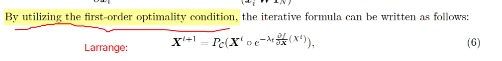

# Thuật toán Bregman Proximal Gradient (BPG)

Tài liệu gốc: [BPG.pdf](research/BPG.pdf) - Mục 3.1

### 1. Mô hình toán học Normalized Cut (NCut)
Bài toán phân bổ dữ liệu được phát biểu dưới dạng tối ưu phân cụm đồ thị:

$$\min_{X \in \mathcal{C}} f(X) = \sum_{i=1}^K \frac{x_i^T W (\mathbf{1}_N - x_i)}{x_i^T W \mathbf{1}_N}$$

Trong đó:
- $W \in \mathbb{R}^{N \times N}$ là ma trận ái lực đo tần suất giao dịch đồng thời giữa các tuple
- $x_i$ là vector cột thứ $i$ của ma trận $X$, biểu diễn mức độ thuộc về máy chủ thứ $i$
- $\mathbf{1}_N$ là vector toàn số 1 độ dài $N$
- Tử số $x_i^T W (\mathbf{1}_N - x_i)$ đo tổng trọng số các cạnh bị cắt (chi phí nghẽn mạng)
- Mẫu số $x_i^T W \mathbf{1}_N$ đo khối lượng công việc (volume/workload) của máy chủ thứ $i$
- Không gian ràng buộc xác suất $\mathcal{C}$:

$$\mathcal{C} = \{ X \in \mathbb{R}^{N \times K} \mid x_{ij} \ge 0, \;\sum_{j=1}^K x_{ij} = 1 \}$$

---

### 2. Công thức Gradient của hàm mục tiêu
Đạo hàm riêng của hàm mục tiêu theo từng vector cột $x_i$:

$$g_i = \nabla_{x_i} f(X) = \frac{(x_i^T W \mathbf{1}_N)(W \mathbf{1}_N - 2W x_i) - x_i^T W (\mathbf{1}_N - x_i) W \mathbf{1}_N}{(x_i^T W \mathbf{1}_N)^2}$$

Ma trận Gradient tổng hợp tại bước lặp $t$:

$$G^{(t)} = \begin{bmatrix} g_1^{(t)} & g_2^{(t)} & \dots & g_K^{(t)} \end{bmatrix}$$

---

### 3. Công thức lặp BPG (Công thức 6 trong bài báo)



$$X^{(t+1)} = P_C \big( X^{(t)} \odot \exp(-\lambda_t G^{(t)}) \big)$$

Quy trình tính toán gồm 2 bước:

**Bước 1: Cập nhật ma trận theo hàm mũ (nhân Hadamard $\odot$)**:

$$Y = X^{(t)} \odot \exp(-\lambda_t G^{(t)})$$

**Bước 2: Phép chiếu Bregman $P_C$ (chuẩn hóa từng dòng về tổng 100%)**:

$$X_{ij}^{(t+1)} = \frac{Y_{ij}}{\sum_{k=1}^K Y_{ik}}$$


---

### 4. Ví dụ số học trực quan: Dịch chuyển xác suất

Xét một khách hàng đang được phân vân giữa **Máy A** và **Máy B** với tỉ lệ ban đầu 50% - 50%:

$$X^{(t)} = \begin{bmatrix} 0.5 & 0.5 \end{bmatrix}$$

1. **Đo độ dốc chi phí (Gradient $G$)**:
   - Ném vào Máy A làm tăng giao dịch chéo mạng: $g_A = +2$
   - Ném vào Máy B giúp giao dịch nội bộ tại chỗ: $g_B = -1$

$$G = \begin{bmatrix} +2 & -1 \end{bmatrix}$$

2. **Tính điểm thưởng phạt hàm mũ**:
   - Máy A bị phạt: $e^{-(+2)} = e^{-2} \approx 0.135$
   - Máy B được thưởng: $e^{-(-1)} = e^1 \approx 2.718$

$$\exp(-G) \approx \begin{bmatrix} 0.135 & 2.718 \end{bmatrix}$$

3. **Nhân điểm vào xác suất ban đầu (Bước $Y$)**:

$$Y = X^{(t)} \odot \exp(-G) \approx \begin{bmatrix} 0.5 \times 0.135 & 0.5 \times 2.718 \end{bmatrix} = \begin{bmatrix} 0.0675 & 1.359 \end{bmatrix}$$

4. **Phép chiếu $P_C$ chuẩn hóa về 100%**:
   - Tổng điểm: $0.0675 + 1.359 = 1.4265$

$$X^{(t+1)} = \begin{bmatrix} \frac{0.0675}{1.4265} & \frac{1.359}{1.4265} \end{bmatrix} \approx \begin{bmatrix} 0.047 & 0.953 \end{bmatrix}$$

=> Sau 1 bước, xác suất của Máy B tăng vọt từ $50\%$ lên $95.3\%$, kéo dữ liệu về đúng máy chủ tối ưu

---

### 5. So sánh bản chất tư duy: Algorithm 5 vs BPG

| Tiêu chí | Algorithm 5 (Cách cũ của Schreiner) | BPG (Cách mới đề xuất) |
|---|---|---|
| **Triết lý giải thuật** | Tham lam cục bộ (Greedy) | Tối ưu hóa toàn cục (Normalized Cut) |
| **Cách nhìn dữ liệu** | Nhìn từng người một theo thứ tự tải nặng đến nhẹ | Nhìn toàn bộ ma trận ái lực $W$ của toàn hệ thống |
| **Cách xử lý đôi bạn thân** | Thấy Khách 1 và Khách 2 đều bận rộn nên tách đôi ra 2 máy cho đều tải | Nhận ra Khách 1 và Khách 2 liên kết 5.0 cực mạnh nên bắt buộc gom chung vào Site 0 |
| **Xử lý ràng buộc** | Gom cụm thô (coarsening) rồi gán cứng từng hạt giống (seed) | Dùng không gian xác suất mềm liên tục rồi làm tròn rời rạc (Soft to Hard) |
| **Chi phí nghẽn mạng** | Rất cao (**6.0**) do xé nát các giao dịch lớn | Rất thấp (**1.0**) do bảo toàn trọn vẹn các cụm giao dịch nội bộ |
| **Độ cân bằng tải** | Lệch nhiều (Site 0: 40%, Site 1: 60%) | Rất đều (Site 0: 55%, Site 1: 45%) |

---

### 6. Kết quả thực nghiệm đối đầu trên Mock Data

Khi chạy lệnh `just test`, kết quả so sánh số liệu thực tế hiện ra rõ rệt:

```text
=== COMPARISON: ALGORITHM 5 VS BPG ===
+-------------------------------------+-------------------------+----------------------+
|              Criterion              |   Algorithm 5 (Greedy)  | BPG (Normalized Cut) |
+-------------------------------------+-------------------------+----------------------+
|           Site 0 Workload           |        8.0 (40%)        |      11.0 (55%)      |
|           Site 1 Workload           |        12.0 (60%)       |      9.0 (45%)       |
|       Number of Critical Edges      | 3 edges (1-3, 2-4, 5-9) |     1 edge (2-6)     |
| Total Cut Weight (Network Overhead) |           6.0           |         1.0          |
|          Overhead Reduction         |         Baseline        |        -83.3%        |
+-------------------------------------+-------------------------+----------------------+
```
