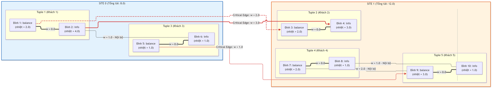

### Bảng 1 giải thích điều gì? ("Ai ở phòng nào sau khi chia?")

```text
+-----------+---------------------+-----------------+----------------+
| Partition |   Nodes (Vertices)  | Tuples Included | Total Workload |
+-----------+---------------------+-----------------+----------------+
|   Site 0  |     [1, 2, 5, 6]    |      [1, 3]     |      8.0       |
|   Site 1  | [3, 4, 7, 8, 9, 10] |    [2, 4, 5]    |      12.0      |
+-----------+---------------------+-----------------+----------------+
```

Bảng này chỉ đơn giản là danh sách phân công:
- Có 2 phòng (Site 0 và Site 1)
- **Site 0** được giao quản lý: Khách số 1 và Khách số 3. Tổng lượng công việc phải phục vụ là 8.0
- **Site 1** được giao quản lý: Khách số 2, Khách số 4, Khách số 5. Tổng lượng công việc phải phục vụ là 12.0
- Về mặt chia việc (tải 8.0 và 12.0): Trông có vẻ khá ổn, không bên nào bị quá tải

---

### Bảng 2 giải thích điều gì? ("Những ai thân nhau mà lại bị chia cắt?")

```text
+-----------------------+-----------+---------+-------------------+
| Critical Edge (u - v) | From Site | To Site | Weight (Overhead) |
+-----------------------+-----------+---------+-------------------+
|         1 - 3         |   Site 0  |  Site 1 |        2.0        |
|         2 - 4         |   Site 0  |  Site 1 |        3.0        |
|         5 - 9         |   Site 0  |  Site 1 |        1.0        |
+-----------------------+-----------+---------+-------------------+
Total distributed transaction cost (Cut Weight): 6.0
```

Bảng này liệt kê **những giao dịch bị biến thành giao dịch phân tán qua mạng**:
- Dòng 1 và dòng 2: Khách 1 (ở Site 0) và Khách 2 (ở Site 1) chuyển tiền và gửi email cho nhau tổng cộng 5 lần (trọng số 2.0 + 3.0)
- Vì một người ở Site 0, một người ở Site 1, nên mỗi lần họ giao dịch là **hai máy chủ phải gửi gói tin qua mạng cho nhau**
- Tổng chi phí "nghẽn mạng" mà hệ thống phải chịu là **6.0**

---

### Vậy nhược điểm của Algorithm 5 là gì? Vì sao nó chia dở?

Hãy nhìn vào cách Algorithm 5 tư duy: Nó là đứa **"tham lam và nhìn ngắn"**:

1. **Nó chỉ mải chia đều người nặng ký**:
   - Khi quét qua dữ liệu, nó thấy Khách 1 bận rộn nhất (VIP 1) và Khách 2 bận rộn nhì (VIP 2)
   - Nó lập tức nghĩ: *"À, tao phải tách 2 người này ra 2 phòng khác nhau cho đỡ nặng phòng: Khách 1 sang Site 0, Khách 2 sang Site 1"*

2. **Cái giá phải trả (Nhược điểm chết người)**:
   - Nó **quên mất không kiểm tra xem Khách 1 và Khách 2 có phải là đôi bạn thân hay không**
   - Trong thực tế, Khách 1 và Khách 2 lại là 2 người hay chuyển tiền cho nhau nhiều nhất
   - Việc tách đôi bạn này sang 2 máy chủ khác nhau đã chặt đứt sợi dây liên kết lớn nhất, khiến mạng giữa 2 máy chủ bị gọi qua lại liên tục (dính ngay chi phí 5.0)

---

### Nếu chia thông minh thì sẽ như thế nào?

Một thuật toán thông minh (như BPG) khi nhìn toàn cảnh sẽ thấy:
- Khách 1 và Khách 2 chơi thân với nhau: **Gom cả 1 và 2 vào cùng Site 0**
- Khách 4 và Khách 5 chơi thân với nhau: **Gom cả 4 và 5 vào cùng Site 1**
- Khách 3 ít việc: Xếp vào bên nào cũng được

Khi đó:
- Đôi bạn 1 và 2 nói chuyện nội bộ trong Site 0, không tốn 1 byte mạng nào
- Chi phí nghẽn mạng sẽ giảm từ **6.0 tụt thẳng xuống chỉ còn 1.0**

Xem tiếp [partition_scheme_bpg](partition_scheme_bpg.md)
